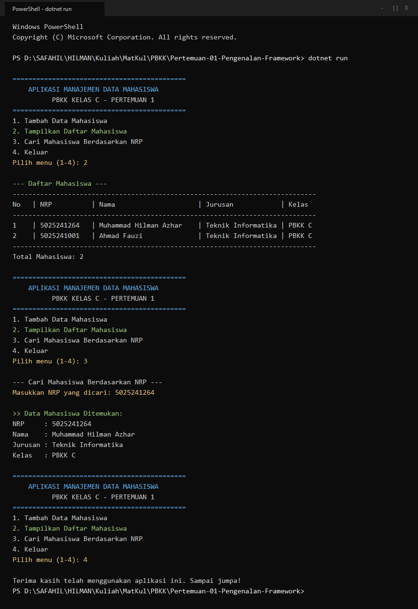

# Pertemuan 01: Pengenalan Framework & Program Data Mahasiswa

Implementasi kode program dan dokumentasi pengujian tugas Pertemuan 01 mata kuliah Pemrograman Berbasis Kerangka Kerja (PBKK) C.

## Identitas
- **Nama:** Muhammad Hilman Azhar
- **NRP:** 5025241264
- **Kelas:** PBKK C
- **Dosen Pengampu:** Fajar Baskoro, S.Kom., M.T.
- **Laporan Notion:** [Buka Laporan di Notion](https://app.notion.com/p/Pertemuan-1-Pengenalan-Framework-Program-Data-Mahasiswa-4009c0720c5a81518a79c91d73d45da2)

## Deskripsi Singkat
Latihan pemrograman dasar C# Console menggunakan class entitas `Mahasiswa` dan koleksi `List<T>` di memori. Fitur program mencakup penambahan data, penampilan tabel data, dan pencarian mahasiswa berdasarkan NRP.

## Struktur Berkas
- `Program.cs`: Berkas utama program C# (model entitas, data awal, dan logika menu).
- `Pertemuan-01-Pengenalan-Framework.csproj`: Berkas konfigurasi proyek .NET 10.0 Console.
- `screenshots/terminal_run.png`: Bukti tangkapan layar eksekusi program di terminal.

## Cara Menjalankan
Pastikan .NET SDK telah terinstal di komputer.

```bash
dotnet run
```

## Hasil Eksekusi
Tampilan output saat program dijalankan dan diuji melalui terminal:


