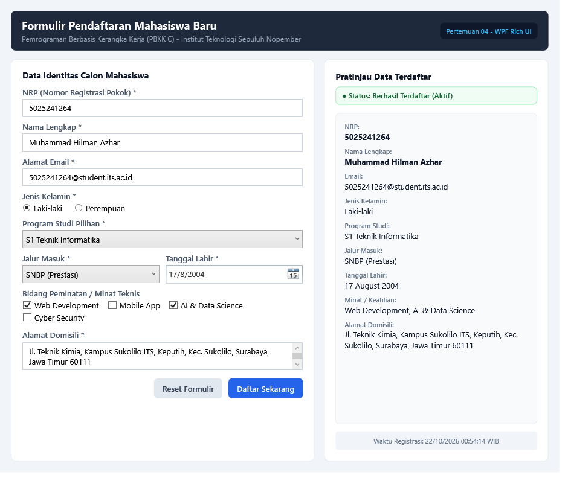

# Pertemuan 04: WPF Rich UI - Formulir Registrasi Mahasiswa

Implementasi antarmuka formulir pendaftaran mahasiswa baru berbasis Windows Presentation Foundation (WPF) dan C# untuk tugas Pertemuan 04 mata kuliah Pemrograman Berbasis Kerangka Kerja (PBKK) C.

## Identitas
- **Nama:** Muhammad Hilman Azhar
- **NRP:** 5025241264
- **Kelas:** PBKK C
- **Dosen Pengampu:** Fajar Baskoro, S.Kom., M.T.
- **Laporan Notion:** [Buka Laporan di Notion](https://app.notion.com/p/Pertemuan-4-WPF-Rich-UI-Formulir-Registrasi-Mahasiswa-4009c0720c5a81e1a9fbe80d9d628072)

## Deskripsi Singkat
Aplikasi formulir registrasi mahasiswa menggunakan layout modern dua kolom berbasis XAML dan interaksi logika di code-behind (`MainWindow.xaml.cs`). Fitur yang diimplementasikan:
1. **Penggunaan Ragam Kontrol Input WPF:**
   - `TextBox`: Input NRP, Nama Lengkap, Email, dan Alamat (multi-line).
   - `RadioButton`: Pilihan jenis kelamin (Laki-laki / Perempuan).
   - `ComboBox`: Pilihan Program Studi dan Jalur Masuk (SNBP, SNBT, Mandiri, Kemitraan).
   - `DatePicker`: Pemilihan tanggal lahir kalender interaktif.
   - `CheckBox`: Minat teknis mahasiswa (Web, Mobile, AI/Data Science, Cyber Security).
2. **Validasi Input Terstruktur:**
   - Cek nilai numerik NRP.
   - Cek panjang karakter nama (minimal 3 karakter).
   - Validasi format email sederhana (`@` dan domain).
   - Validasi tanggal lahir dan alamat domisili.
3. **Kartu Pratinjau Data (Live Summary):**
   - Menampilkan rekapitulasi data mahasiswa yang berhasil didaftarkan.
   - Indikator badge status pendaftaran (`Belum Didaftarkan` vs `Berhasil Terdaftar (Aktif)`).
   - Penanda waktu pendaftaran secara presisi.
4. **Fitur Reset Formulir:**
   - Mengosongkan seluruh field input dan mengembalikan kartu pratinjau ke keadaan awal.

## Struktur Berkas
- `MainWindow.xaml`: Desain antarmuka visual dua kolom dengan styling kontrol kustom.
- `MainWindow.xaml.cs`: Logika validasi input, penarikan nilai kontrol, dan mekanisme reset.
- `Pertemuan-04-WPF-Student-Registration.csproj`: Konfigurasi proyek WPF berbasis .NET 10.0.
- `screenshots/registration_gui.png`: Tangkapan layar hasil eksekusi aplikasi saat data terisi dan tervalidasi.

## Cara Menjalankan
Pastikan .NET SDK (8.0 / 10.0) telah terpasang di sistem operasi Windows.

```bash
dotnet run
```

## Hasil Eksekusi
Tampilan jendela aplikasi formulir registrasi mahasiswa desktop WPF:


